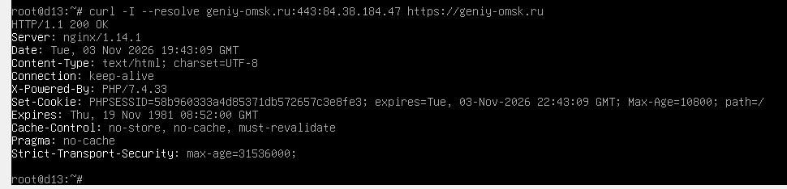
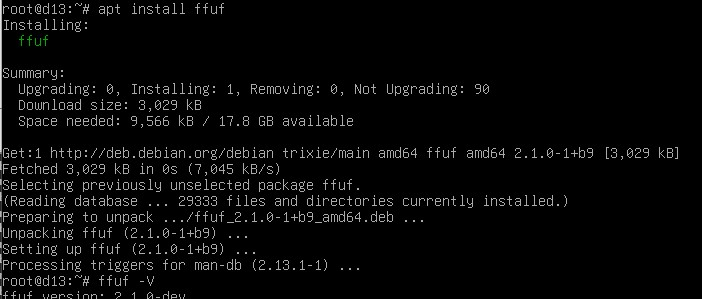
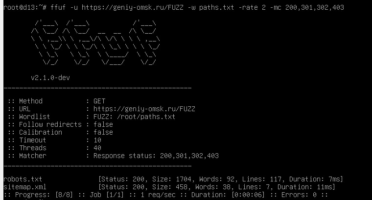

### Лабораторная работа со звёздочкой

### Как (не) стать маминым хакером

### Задание

Почувствовать себя настоящим хакером (в рамках закона и лабораторной) и проверить сайт минимум на три уязвимости, связанные с ошибками конфигурации Nginx.

### Ход работы

### Поиск сайта

На удивление, это было самой долгой частью моей работы. Я долго думала, до чего бы дотянуть свои ручки, да так, чтобы люди в чёрном не пришли к моей двери.

Вначале у меня появилась светлая идея - взломать того, кто и выдал это задание, то есть позариться на какой-нибудь из сайтов университета. Однако я довольно быстро поняла, что моих нулевых навыков для подобной операции не хватит. Да и вообще, я всё ещё хочу доучиться в этом вузе до выпускного.

Поразмыслив ещё немного, я решила позариться на сайт `vilate.ru`, принадлежащий компании где я работала этим летом. Подумав, что в крайнем случае смогу с ними договориться. Однако и тут не прокатило: их защита оказалась для меня слишком сильной. Их сайт просто не работал... (Что-то мне подсказывает, что до недавнего времени он находился на облаке Яндекса)

Как говорится, нельзя сломать то, что уже сломано. Поэтому пришлось искать дальше. Думала я пару часов. И тут мне в голову пришла замечательная идея - позариться на сайт моей 107-й Омской школы, назло всем преподавателям, которые говорили, что из нас - самого тупого класса, который они когда-либо видели - ничего не выйдет.

Однако увидев в адресе сайта gosuslugi.ru и вспомнив о людях в чёрном, я решила сменить цель.

В этот раз я приняла решение найти себе достойного соперника. И наконец остановила свой выбор на сайте омского частного детского сада `geniy-omsk.ru`.

### Знакомство с сайтом

Для начала проверяю доступность сайта и изучаю HTTP-заголовки. Сервер отвечает кодом `200 OK` и сообщает `nginx/1.14.1`. Также в заголовках присутствует информация о `PHP/7.4.33`.

Само отображение версии не доказывает наличие уязвимости: для подтверждения необходимо проверить конкретное поведение сервера.

Из-за проблем с DNS внутри виртуальной машины выполняю запросы с указанием IP-адреса через параметр `--resolve`.

### Перебор страниц через ffuf

Устанавливаю утилиту `ffuf` и подготавливаю небольшой список типовых путей. Проверку выполняю с небольшой частотой запросов, без подбора паролей и без создания нагрузки на сайт.

В результате обнаруживаю `robots.txt` и `sitemap.xml`. Затем отдельно проверяю некоторые пути, перечисленные в `robots.txt`, включая `/elements` и `/addon-pages`.

Они возвращают обычные публичные HTML-страницы. Признаков доступа к закрытой административной информации не обнаруживаю.

### Проверка Path Traversal

Проверяю обработку относительного пути `../` в URL. Для этого отправляю запрос к адресу, содержащему переход к родительскому каталогу, и использую параметр `--path-as-is`, чтобы `curl` не нормализовал путь самостоятельно.

Сервер возвращает `HTTP/1.1 404 Not Found`. Доступ к ресурсу за пределами запрошенного пути не получаю, поэтому Path Traversal в рамках этой проверки не подтверждается.

### Проверка открытого листинга директорий

Дополнительно проверяю доступность пути `/core/` на предмет открытого листинга директорий.

Сервер возвращает страницу ошибки `404`, оформленную в дизайне сайта. Список файлов и каталогов не отображается.

### Вывод

К сожалению, никаких значимых результатов я так и не добилась. А значит, маминым хакером я пока не стала…

